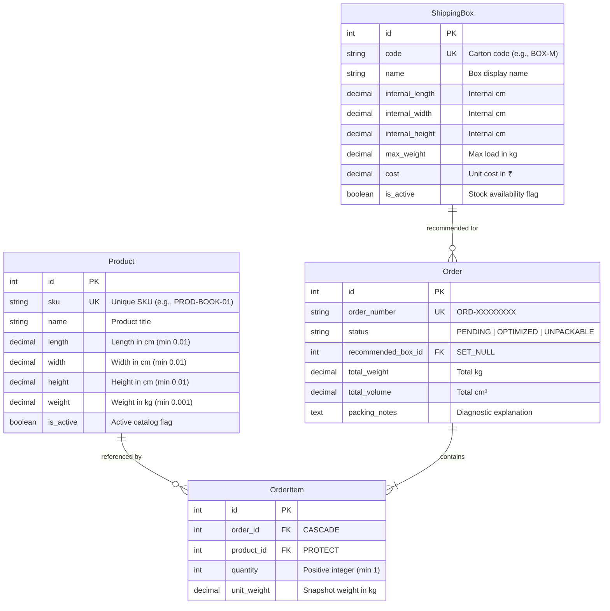

# AI-Assisted Box Selection System

An automated, production-grade warehouse packaging optimization platform built with Python and Django. The system dynamically evaluates customer orders against available warehouse carton inventory to recommend the **lowest-cost feasible shipping box** that safely satisfies 3D geometric dimensions, spatial rotations, and weight limits.

---

## Table of Contents

1. [Project Overview](#project-overview)
2. [Problem Statement](#problem-statement)
3. [Features](#features)
4. [Technology Stack](#technology-stack)
5. [System Architecture](#system-architecture)
6. [Database Design](#database-design)
7. [Box Selection Algorithm](#box-selection-algorithm)
8. [Algorithm Assumptions & Limitations](#algorithm-assumptions--limitations)
9. [Project Folder Structure](#project-folder-structure)
10. [Installation Instructions](#installation-instructions)
11. [Environment Setup](#environment-setup)
12. [Database Migration & Seeding](#database-migration--seeding)
13. [How to Run the Application](#how-to-run-the-application)
14. [How to Run Tests](#how-to-run-tests)
15. [Example Usage (Sample Input & Output)](#example-usage-sample-input--output)

---

## 1. Project Overview

In high-volume ecommerce fulfillment centers, choosing the wrong carton size leads to inflated dimensional-weight freight charges, excess void fill (bubble wrap/kraft paper), box structural failure, and elevated carbon footprint.

The **AI-Assisted Box Selection System** replaces manual packaging guesswork with a deterministic, pure-Python 3D bin packing engine integrated seamlessly into a Django operations dashboard.

---

## 2. Problem Statement

Given:
* A customer order comprising one or more products, each defined by physical `length`, `width`, `height` (in centimeters), and `weight` (in kilograms), along with an ordered `quantity`.
* A catalog of standard shipping boxes, each defined by internal `length`, `width`, `height`, `max_weight` capacity, and unit `cost` (in ₹).

The system must:
1. Validate all product and box parameters against non-negative, non-zero physical constraints.
2. Determine whether any available carton can accommodate all items simultaneously without 3D geometric overlap.
3. Evaluate all 6 orthogonal 3D spatial rotations for each item.
4. Recommend the **cheapest eligible carton** that satisfies all weight and volume constraints.
5. Provide actionable, human-readable diagnostic explanations when an order cannot be accommodated.

---

## 3. Features

* **3D Bin Packing Engine:** Pure Python geometric placement engine using First-Fit Decreasing (FFD) heuristics and 3D Extreme Point (Anchor Coordinate) tracking.
* **6-Axis Spatial Rotation:** Tests all unique orthogonal orientations ($L \times W \times H$ permutations) for each product to find valid placements.
* **3-Stage Filter-and-Verify Pipeline:**
  * **Stage 1 (Fast Filters):** Rapidly eliminates ineligible boxes using weight capacity, total volume, and sorted bounding-box dimension checks ($O(1)$ per box).
  * **Stage 2 (Cost Ranking):** Ranks candidate boxes ascending by unit cost, using internal volume as a tie-breaker (minimizing empty void space).
  * **Stage 3 (3D Simulation):** Simulates coordinate placement starting from the cheapest box; returns the first feasible candidate.
* **Dynamic Order Entry UI:** Dynamic Django FormSet allowing warehouse operators to add and remove item rows without phantom blank row submission errors.
* **Transparent Packaging Advice:** Detailed metrics for each recommendation including container space utilization %, remaining void volume for dunnage, remaining weight capacity, and exact 3D placement coordinates $(x, y, z, \Delta x, \Delta y, \Delta z)$.
* **Intelligent Failure Diagnostics:** Identifies specific root causes for unpackable orders (e.g., oversized SKUs exceeding all inventory dimensions, weight capacity overage, or cumulative volume conflicts).
* **Catalog Management:** Full CRUD interfaces for Products and Shipping Boxes with referential integrity protection (`models.PROTECT`).
* **Warehouse KPI Dashboard:** Operational metrics displaying total products, active boxes, total orders, optimization success rate, and recent recommendations.

---

## 4. Technology Stack

* **Language:** Python 3.10+ (tested on Python 3.14)
* **Web Framework:** Django 6.1 (MTV architecture, ORM, Forms, Templates)
* **Database:** SQLite 3 (configured with strict `CheckConstraint` and `UniqueConstraint` guards)
* **Frontend:** HTML5, Bootstrap 5.3.3 (CDN), Bootstrap Icons 1.11.3, Vanilla JavaScript (zero node/npm build dependencies)
* **Standard Library Dependencies:** `decimal` (exact decimal arithmetic), `dataclasses` (immutable specs), `itertools` (rotation permutations), `uuid` (unique order referencing).

---

## 5. System Architecture

The application strictly follows the **Service Layer Pattern** to isolate physical packing algorithms from web presentation and database storage:

```
┌────────────────────────────────────────────────────────────────────────┐
│                        Presentation Layer                              │
│       Django Templates (Bootstrap 5) + Forms + Views (HTTP)            │
│  [dashboard_views.py]   [catalog_views.py]   [order_views.py]          │
└───────────────────────────────────┬────────────────────────────────────┘
                                    │
                                    ▼
┌────────────────────────────────────────────────────────────────────────┐
│                          Service Layer                                 │
│  • BoxSelectorService: 3-stage candidate filter, cost ranking,         │
│    and order persistence orchestration.                                │
│  • PackingEngine: Pure Python 3D geometric placement (FFD +            │
│    Extreme Points + 6-axis AABB rotation).                             │
│  • PackingAdvisor: Human-readable reasoning and failure diagnostics.   │
└───────────────────────────────────┬────────────────────────────────────┘
                                    │
                                    ▼
┌────────────────────────────────────────────────────────────────────────┐
│                        Persistence Layer                               │
│       Django ORM Models (Product, ShippingBox, Order, OrderItem)       │
│       DecimalField math, DB CheckConstraints, and Foreign Keys         │
└────────────────────────────────────────────────────────────────────────┘
```

---

## 6. Database Design



### Key Relational Constraints

* **`Product.sku` & `ShippingBox.code`:** Enforced as unique indexed fields.
* **`OrderItem.product` (`on_delete=models.PROTECT`):** Prevents deletion of catalog products that are referenced in historical fulfillment orders.
* **`Order.recommended_box` (`on_delete=models.SET_NULL`):** Deleting or retiring a box type preserves historical order records with a `NULL` box reference.
* **`UniqueConstraint(fields=['order', 'product'])`:** Prevents duplicate line items for the same product within a single order.
* **`CheckConstraint`:** Applied at the database engine level to reject zero or negative dimensions, weights, and costs.

---

## 7. Box Selection Algorithm

The recommendation engine operates in three sequential stages:

```
[Customer Order Items]
         │
         ▼
┌─────────────────────────────────────────────────────────┐
│ Stage 1: Fast O(1) Pre-Filters (Per Box)                │
│ • Total Weight <= Box Max Weight Capacity               │
│ • Total Volume <= Box Internal Volume                   │
│ • Max Item Dimension <= Max Box Dimension (Rotated)     │
└────────────────────────┬────────────────────────────────┘
                         │ (Remaining Candidates)
                         ▼
┌─────────────────────────────────────────────────────────┐
│ Stage 2: Cost-Ascending Ranking                         │
│ • Sort by Unit Cost ASC (Cheapest First)                │
│ • Tie-breaker: Internal Volume ASC (Tightest Fit)       │
└────────────────────────┬────────────────────────────────┘
                         │ (Ordered Candidates)
                         ▼
┌─────────────────────────────────────────────────────────┐
│ Stage 3: 3D Coordinate Simulation                       │
│ • First-Fit Decreasing (FFD) item volume sort           │
│ • Extreme Point (Anchor Coordinate) exploration         │
│ • 6-axis orthogonal rotation testing per item           │
│ • AABB collision detection                              │
└────────────────────────┬────────────────────────────────┘
                         │
             ┌───────────┴───────────┐
             ▼                       ▼
      [First Valid Box]     [All Candidates Fail]
      Status: OPTIMIZED     Status: UNPACKABLE
      Cheapest Guarantee    Actionable Diagnostics
```

### Why Volume Comparison Alone Is Insufficient

A common pitfall in packing systems is relying solely on total volume ($\sum V_{items} \le V_{box}$). Volume comparison assumes items behave like liquids or granular materials. 

**Counter-example:** A fluorescent light tube ($100 \times 3 \times 3\text{ cm}$) has a volume of only $900\text{ cm}^3$. A cubic box ($20 \times 20 \times 20\text{ cm}$) has an internal volume of $8,000\text{ cm}^3$. Although the box has nearly $9\times$ the required volume, the tube physically cannot fit along any axis. The `PackingEngine` verifies physical, non-overlapping coordinate boundaries.

---

## 8. Algorithm Assumptions & Limitations

### Assumptions
1. **Rectangular Cuboids:** All items and boxes are modeled as axis-aligned rectangular cuboids. Irregular items (e.g., spheres, cones) must be modeled using their bounding boxes.
2. **Homogeneous Weight:** Items have uniform mass distribution (center of gravity equals geometric center).
3. **Rigid Bodies:** Items are non-deformable and non-compressible (e.g., apparel is treated as rigid based on folded dimensions).
4. **Single-Box Fulfillment:** The system identifies a single carton that accommodates all items in the order.

### Known Limitations
1. **No Multi-Box Splitting:** Orders exceeding the capacity of the largest carton are marked `UNPACKABLE`. Multi-parcel splitting (Bin Packing with multiple output bins) is not currently performed.
2. **No Physical Support/Gravity Simulation:** Placements are verified by 3D coordinate non-overlap (AABB). The engine does not simulate gravity or require full base support under stacked items.
3. **Worst-Case Complexity:** Testing permutations of $N$ items across $A$ anchor points with 6 rotations is $O(N \log N + N \cdot A \cdot 6 \cdot P)$, which is suitable for standard retail orders ($< 50$ items), but requires batching for massive quantities ($> 500$ units).

---

## 9. Project Folder Structure

```
Box Selection System/
├── config/                         # Django Project Configuration
│   ├── settings.py                 # Core settings, database, templates
│   ├── urls.py                     # Root URL routing
│   ├── wsgi.py                     # WSGI deployment entry point
│   └── asgi.py                     # ASGI deployment entry point
├── fulfillment/                    # Main Fulfillment Application
│   ├── admin.py                    # Django Admin registrations
│   ├── apps.py                     # App configuration
│   ├── models/                     # Database Models (Modularized)
│   │   ├── __init__.py             # Model exports
│   │   ├── product.py              # Product entity & constraints
│   │   ├── box.py                  # ShippingBox entity & constraints
│   │   └── order.py                # Order & OrderItem entities
│   ├── services/                   # Decoupled Business Logic
│   │   ├── packing_engine.py       # Pure Python 3D geometric placement
│   │   ├── box_selector.py         # Multi-stage selection coordinator
│   │   └── packing_advisor.py      # Explanations & failure diagnostics
│   ├── forms/                      # Django Forms
│   │   ├── __init__.py             # Form exports
│   │   ├── catalog_forms.py        # Product & Box management forms
│   │   └── order_forms.py          # Dynamic OrderItem formset
│   ├── views/                      # Application Views
│   │   ├── __init__.py             # View exports
│   │   ├── dashboard_views.py      # Warehouse KPI dashboard
│   │   ├── catalog_views.py        # Product & Box CRUD views
│   │   └── order_views.py          # Order entry & recommendation views
│   ├── management/commands/        # Custom CLI Management Commands
│   │   └── populate_catalog.py     # Seeds sample warehouse catalog
│   ├── tests/                      # Automated Test Suite (76 Tests)
│   │   ├── __init__.py             # Test suite discovery
│   │   ├── test_models.py          # Model validations & constraints
│   │   ├── test_packing_engine.py  # 3D placement & collision checks
│   │   ├── test_box_selector.py    # Cost ranking & tie-breakers
│   │   ├── test_formset.py         # Dynamic formset behavior
│   │   ├── test_views.py           # HTTP endpoints & redirects
│   │   ├── test_ui_smoke.py        # UI template rendering
│   │   └── test_comprehensive_suite.py # 15-category hiring assignment suite
│   └── urls.py                     # Fulfillment URL routes
├── templates/                      # Django HTML Templates
│   └── fulfillment/
│       ├── base.html               # Master layout (Bootstrap 5.3)
│       ├── dashboard.html          # Warehouse KPI dashboard
│       ├── product_list.html       # Products catalog & add form
│       ├── product_edit.html       # Product edit form
│       ├── box_list.html           # Boxes catalog & add form
│       ├── box_edit.html           # Box edit form
│       ├── confirm_delete.html     # Generic delete confirmation
│       ├── order_create.html       # Dynamic order entry interface
│       ├── order_list.html         # Past orders history
│       └── order_recommendation.html # 3D result visualization
├── manage.py                       # Django CLI utility
├── requirements.txt                # Pinned dependencies
└── README.md                       # Project documentation
```

---

## 10. Installation Instructions

### Prerequisites
* **Python 3.10** or higher installed.
* **Git** installed.

### Clone the Repository
```bash
git clone <repository-url> "Box Selection System"
cd "Box Selection System"
```

---

## 11. Environment Setup

### 1. Create and Activate Virtual Environment

**Windows (PowerShell):**
```powershell
python -m venv .venv
.\.venv\Scripts\Activate.ps1
```

**macOS / Linux:**
```bash
python3 -m venv .venv
source .venv/bin/activate
```

### 2. Install Dependencies

```bash
pip install -r requirements.txt
```

*(Note: The core project dependencies are `django>=5.0` with zero binary C-extensions, enabling fast, cross-platform installation.)*

---

## 12. Database Migration & Seeding

### 1. Apply Migrations
```bash
python manage.py migrate
```

### 2. Create Superuser (Optional, for Django Admin)
```bash
python manage.py createsuperuser
```
*(Enter your desired username, email, and password)*

### 3. Seed Realistic Demo Data
The project includes a custom management command that loads 5 industry-standard carton sizes and 6 sample products:
```bash
python manage.py populate_catalog
```

---

## 13. How to Run the Application

Start the Django development server:
```bash
python manage.py runserver
```

Open your browser and navigate to:
* **Warehouse Dashboard:** [http://127.0.0.1:8000/](http://127.0.0.1:8000/)
* **Create New Order:** [http://127.0.0.1:8000/orders/new/](http://127.0.0.1:8000/orders/new/)
* **Order History:** [http://127.0.0.1:8000/orders/](http://127.0.0.1:8000/orders/)
* **Shipping Boxes:** [http://127.0.0.1:8000/boxes/](http://127.0.0.1:8000/boxes/)
* **Product Catalog:** [http://127.0.0.1:8000/products/](http://127.0.0.1:8000/products/)
* **Django Admin:** [http://127.0.0.1:8000/admin/](http://127.0.0.1:8000/admin/)

---

## 14. How to Run Tests

The test suite contains **76 automated tests** providing full coverage across models, 3D placement geometry, views, formsets, and edge cases.

### Run the Complete Test Suite
```bash
python manage.py test fulfillment.tests --verbosity=2
```

### Run Only the 15-Category Comprehensive Suite
```bash
python manage.py test fulfillment.tests.test_comprehensive_suite --verbosity=2
```

### Expected Output
```
Ran 76 tests in 0.698s

OK
Destroying test database for alias 'default' ('file:memorydb_default?mode=memory&cache=shared')...
```

---

## 15. Example Usage (Sample Input & Output)

### Scenario: Packing a Multi-Item Mixed Order

#### Input Order
* **Item 1:** $1\times$ Hardcover Programming Book (`PROD-BOOK-01`)
  * Dimensions: $24.00 \times 17.00 \times 4.50\text{ cm}$
  * Weight: $1.100\text{ kg}$
* **Item 2:** $2\times$ Ceramic Coffee Mug (`PROD-MUG-01`)
  * Dimensions: $11.00 \times 11.00 \times 11.00\text{ cm}$
  * Unit Weight: $0.380\text{ kg}$ ($0.760\text{ kg}$ total)

#### Warehouse Box Catalog Evaluated

| Box Code | Name | Internal Dimensions ($L \times W \times H$) | Max Weight | Unit Cost |
|---|---|---|---|---|
| `BOX-S` | Small Parcel Box | $22.00 \times 16.00 \times 10.00\text{ cm}$ | $3.000\text{ kg}$ | ₹1.25 |
| `BOX-FLAT`| Flat Mailer Box | $38.00 \times 28.00 \times 8.00\text{ cm}$ | $5.000\text{ kg}$ | ₹1.80 |
| `BOX-M` | Medium Shipping Box | $32.00 \times 24.00 \times 16.00\text{ cm}$ | $8.000\text{ kg}$ | ₹2.20 |
| `BOX-L` | Large Shipping Box | $45.00 \times 35.00 \times 25.00\text{ cm}$ | $15.000\text{ kg}$ | ₹3.75 |

#### Execution Trace
1. **Stage 1 (Pre-Filters):**
   * Total Order Weight: $1.100 + 2 \times 0.380 = 1.860\text{ kg}$. (All boxes pass weight filter).
   * Total Order Volume: $(24 \times 17 \times 4.5) + 2 \times (11 \times 11 \times 11) = 1,836 + 2,662 = 4,498.00\text{ cm}^3$.
   * `BOX-S`: Internal volume is $3,520\text{ cm}^3 < 4,498\text{ cm}^3$. **REJECTED (Volume).**
   * `BOX-FLAT`: Internal height is $8.00\text{ cm}$. Mug height is $11.00\text{ cm}$ in all rotations. **REJECTED (Dimension).**
   * Remaining Candidates: `BOX-M` (₹2.20), `BOX-L` (₹3.75).
2. **Stage 2 (Cost Ranking):**
   * Candidates ordered by cost: 1. `BOX-M` (₹2.20), 2. `BOX-L` (₹3.75).
3. **Stage 3 (3D Simulation):**
   * Evaluate `BOX-M` ($32 \times 24 \times 16\text{ cm}$):
     * Places Book flat on carton base at $(0, 0, 0)$.
     * Places Mug 1 at $(24, 0, 0)$ adjacent to Book.
     * Places Mug 2 at $(0, 0, 4.5)$ on Book surface.
     * All items fit within boundaries without collision.
   * **Simulation returns `BOX-M` as optimal.**

#### System Recommendation Output

```json
{
  "order_number": "ORD-B4A1D2C9",
  "status": "OPTIMIZED",
  "recommended_box": {
    "code": "BOX-M",
    "name": "Medium Shipping Box",
    "dimensions": "32.00 × 24.00 × 16.00 cm",
    "cost": "₹2.20",
    "max_weight": "8.000 kg"
  },
  "metrics": {
    "total_order_weight": "1.860 kg",
    "weight_buffer_remaining": "6.140 kg",
    "box_volume": "12,288.0 cm³",
    "item_volume": "4,498.0 cm³",
    "void_volume": "7,790.0 cm³",
    "utilization_percentage": "36.6%"
  },
  "explanation": "Selected Medium Shipping Box (BOX-M) at ₹2.20 as the lowest-cost option among 2 evaluated boxes. Accommodates all items with 36.6% space utilization, leaving 7,790.0 cm³ for protective dunnage. Weight buffer remaining: 6.140 kg."
}
```
